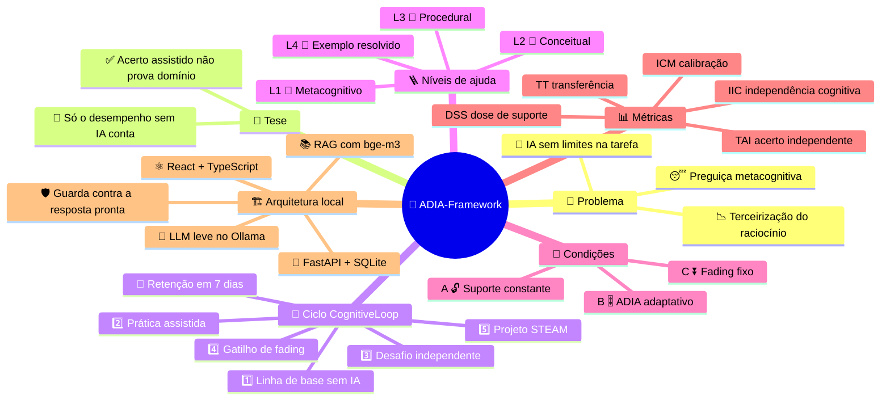
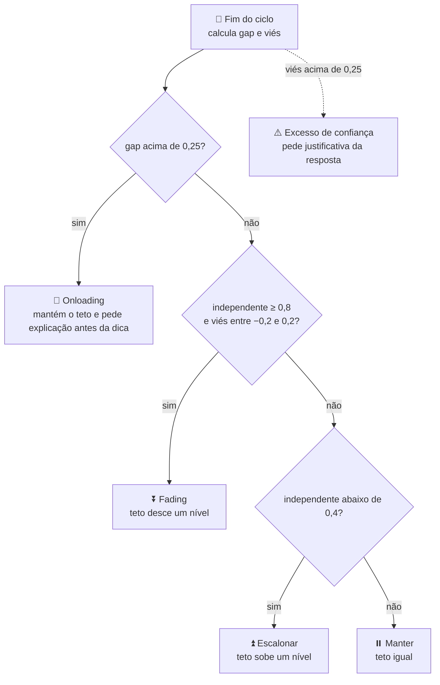
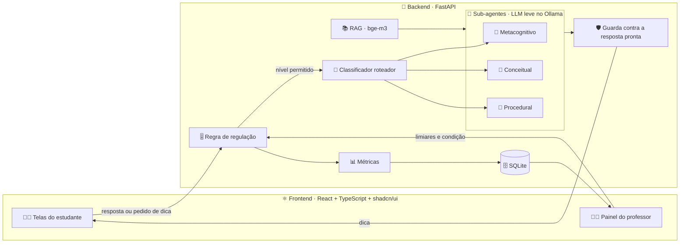

# ADIA-Framework · CognitiveLoop

**Adaptive Decremental Assistance in AI-Supported Learning.** Protótipo de pesquisa que mede quanto um estudante consegue fazer sozinho depois de praticar com IA e, com base nisso, retira o apoio da IA aos poucos.

> Status: em construção, ainda sem código executável.

## Mapa geral



## O problema

A IA generativa melhora o desempenho imediato nas tarefas, mas o uso sem limites leva o estudante a terceirizar o raciocínio (*cognitive offloading*) e a deixar de monitorar o próprio entendimento. Quando a escola conta o acerto feito com ajuda da IA como prova de aprendizado, mistura o que a ferramenta fez com o que o aluno sabe fazer.

Bastani et al. (2025) observaram isso em matemática: estudantes com acesso livre ao GPT-4 se saíram melhor na prática e pior na prova sem IA.

## A tese

**Acerto assistido não prova domínio independente.**

O ADIA só reduz a ajuda quando o estudante mostra desempenho autônomo em tarefas feitas sem IA. O acerto com ajuda entra apenas no cálculo da distância entre o que o aluno faz com apoio e o que faz sozinho.

## Como funciona: o ciclo CognitiveLoop

```
   1. Linha de base (sem IA)
      ↓
┌→ 2. Prática assistida (dicas graduais)
│     ↓
│  3. Desafio independente (IA desativada)
│     ↓
└─ 4. Gatilho de fading (ajusta o teto de ajuda)      × 3 ciclos
      ↓
   5. Projeto STEAM (transferência)  →  Retenção (7 dias)
```

1. Linha de base, sem IA. O estudante resolve problemas de referência e informa a confiança em cada resposta, de 0 a 10. O sistema registra conhecimento prévio, tempo e calibração.
2. Prática assistida. O estudante resolve problemas com acesso a dicas em quatro níveis, e o sistema conta quantas dicas usou e de que nível.
3. Desafio independente. Sem a IA, o estudante resolve problemas equivalentes e um de transferência. Só este desempenho entra no cálculo de proficiência.
4. Gatilho de fading. O sistema compara o desempenho assistido com o independente e define o teto de ajuda do ciclo seguinte.
5. Projeto STEAM. Depois dos ciclos, um projeto interdisciplinar leva o conteúdo a uma situação nova, como o orçamento de placas solares para a escola. As partes numéricas têm correção automática, e o professor avalia a justificativa por rubrica.

Sete dias depois, um teste de retenção repete a estrutura do pós-teste.

### Níveis de ajuda

| Nível | Tipo          | O que a IA faz                                       |
|-------|---------------|------------------------------------------------------|
| L1    | Metacognitivo | Pergunta o que o aluno já sabe e o que o problema pede |
| L2    | Conceitual    | Explica o conceito envolvido                          |
| L3    | Procedural    | Indica o primeiro passo da resolução                  |
| L4    | Exemplo       | Mostra um exemplo resolvido análogo                   |

Nas condições B e C, nenhuma dica revela a resposta do item.

### Regra de regulação

Ao fim de cada ciclo:

- `gap = acerto_assistido − acerto_independente`
- `viés = confiança_média − acerto_independente`

| Situação                                              | Decisão     | Efeito                                    |
|-------------------------------------------------------|-------------|-------------------------------------------|
| independente ≥ 0,8, gap ≤ 0,25 e \|viés\| ≤ 0,2       | Fading      | Teto de ajuda desce um nível              |
| gap > 0,25                                            | Onloading   | Mantém o teto e pede explicação antes da dica |
| independente < 0,4 e gap ≤ 0,25                       | Escalonar   | Teto de ajuda sobe um nível               |
| Qualquer outro caso                                   | Manter      | Teto inalterado                           |

Com viés acima de 0,25, ou seja, excesso de confiança, o aluno também precisa justificar a resposta. O professor pode editar os limiares no painel.



## Desenho experimental

| Condição              | Ajuda disponível                                      | Função no estudo                     |
|-----------------------|-------------------------------------------------------|--------------------------------------|
| A · Suporte constante | Todas as dicas e a opção de ver a resposta            | Controle, com IA sem restrição       |
| B · ADIA              | Teto regulado pela regra acima                        | Condição proposta                    |
| C · Fading fixo       | Teto desce um nível por ciclo, sem olhar o desempenho | Separa o efeito de *adaptar* do efeito de *reduzir* (opcional) |

As três condições registram as mesmas métricas. Nas condições A e C, o sistema também anota o que o ADIA teria decidido.

## Métricas

| Sigla | Nome                               | Cálculo                                                 |
|-------|------------------------------------|---------------------------------------------------------|
| TAI   | Taxa de Acerto Independente        | Acertos sem IA ÷ itens sem IA                           |
| TT    | Taxa de Transferência              | Acertos em itens de transferência ÷ itens de transferência |
| ICM   | Índice de Calibração Metacognitiva | Brier score e viés entre confiança e acerto             |
| DSS   | Dose de Suporte Solicitada         | Dicas usadas ÷ (nível máximo × itens praticados)        |
| IIC   | Índice de Independência Cognitiva  | Acerto independente ÷ acerto assistido, limitado a 1    |
|       | Retenção                           | TAI no teste de 7 dias ÷ TAI no pós-teste               |

O IIC aparece sempre ao lado da TAI, porque quem acerta pouco com e sem ajuda também tem IIC alto.

## Arquitetura do protótipo

Tudo roda localmente, e nenhum dado de estudante vai para serviços externos.

- Frontend: React, Vite, TypeScript e shadcn/ui.
- Backend: Python com FastAPI e SQLite.
- IA local: um modelo de linguagem leve, de 1 a 1,5B parâmetros, rodando no Ollama. A escolha sai de um benchmark curto entre candidatos.
- Orquestração: a regra de regulação decide o nível de ajuda, e um classificador compacto escolhe qual sub-agente responde. Como nenhuma decisão experimental depende do LLM, o estudo é reproduzível.
- Sub-agentes: conceitual, procedural e metacognitivo, como papéis diferentes do mesmo modelo.
- RAG: as respostas se apoiam no material da disciplina, com embeddings `bge-m3`.
- Guarda: se a resposta gerada contiver a solução do item, o sistema a descarta e entrega a dica pré-escrita do mesmo nível.
- Modelagem do aluno (fase 6): Deep Knowledge Tracing com LSTM em PyTorch, treinado primeiro com alunos simulados.



### Telas

1. Onboarding e linha de base: editor de resposta, barra de progresso e seletor de confiança, sem chat.
2. Prática assistida: chat com a IA, botões de dica e o selo do nível de suporte ativo.
3. Desafio independente: problemas equivalentes e de transferência, com o aviso "IA desativada".
4. Painel do estudante: evolução do IIC, matriz confiança × acerto e histórico de autonomia.
5. Painel do professor: visão da turma, mapa de calor de atalhos cognitivos, limiares editáveis, troca de condição, correção do projeto STEAM e exportação em CSV.

## Estrutura do repositório

```
ADIA-Framework/
├─ docs/       proposta, protocolo e decisões
├─ backend/    domínio, API, agentes e testes (Python)
├─ frontend/   interface do estudante e do professor (TypeScript)
├─ ml/         simulador de alunos, DKT e benchmark de LLMs
└─ data/       corpus do RAG e cenários STEAM
```

## Como usar

Os comandos para subir o backend e o frontend entram aqui junto com as fases 2 e 3.

Requisitos previstos: Node.js 24, Python 3.14, [uv](https://docs.astral.sh/uv/) e [Ollama](https://ollama.com/).

O pesquisador cria uma turma, escolhe as condições e exporta os dados para análise. O professor acompanha a turma, ajusta os limiares e corrige os projetos STEAM. O estudante percorre o ciclo e acompanha a própria evolução de autonomia.

## Roteiro

- [ ] Fase 0, fundação: README, `.gitignore` e documento de decisões
- [ ] Fase 1, núcleo: banco de itens, correção, regra de regulação, métricas e sessão, com testes
- [ ] Fase 2, API: FastAPI, SQLite, registro de eventos e exportação CSV
- [ ] Fase 3, interface: as cinco telas e o projeto STEAM, com dicas pré-escritas
- [ ] Fase 4, IA local: benchmark de modelos, sub-agentes, roteador, RAG e guarda
- [ ] Fase 5, painel do professor: turma, mapa de calor, limiares e rubrica
- [ ] Fase 6, validação: alunos simulados, análise de poder e DKT
- [ ] Fase 7, piloto: teste com estudantes e ajustes

## Referências principais

- Bastani, H., et al. (2025). Generative AI without guardrails can harm learning: evidence from high school mathematics. *PNAS*, 122(26).
- Hefter, M. H. (2026). The illusion of outsourcing learning: A learner-centered perspective on AI in education.
- Koedinger, K. R., & Aleven, V. (2007). Exploring the assistance dilemma in experiments with cognitive tutors. *Educational Psychology Review*, 19(3).
- Kozachek, D., & Janson, A. (2026). Orchestrating Scaffolding AI Agents: Design Principles for Mechanism-Specific Support.
- Li, X., Fan, Y., Gašević, D., et al. (2026). FLoRA: an advanced AI-powered engine to facilitate hybrid human-AI regulated learning. *Computers & Education*, 243.
- Renkl, A., & Atkinson, R. K. (2003). Structuring the transition from example study to problem solving in cognitive skill acquisition. *Educational Psychologist*, 38(1).
- Wood, D., Bruner, J. S., & Ross, G. (1976). The role of tutoring in problem solving. *Journal of Child Psychology and Psychiatry*, 17(2).
- Trabalhos do BRACIS / ENIAC 2026: Gouvêa et al. (agente de RL em tutor inteligente), Victorio et al. (roteadores de LLM destilados) e Medeiros et al. (LLMs locais em tutoria).

## Autor

Lucas Abreu Estrela
